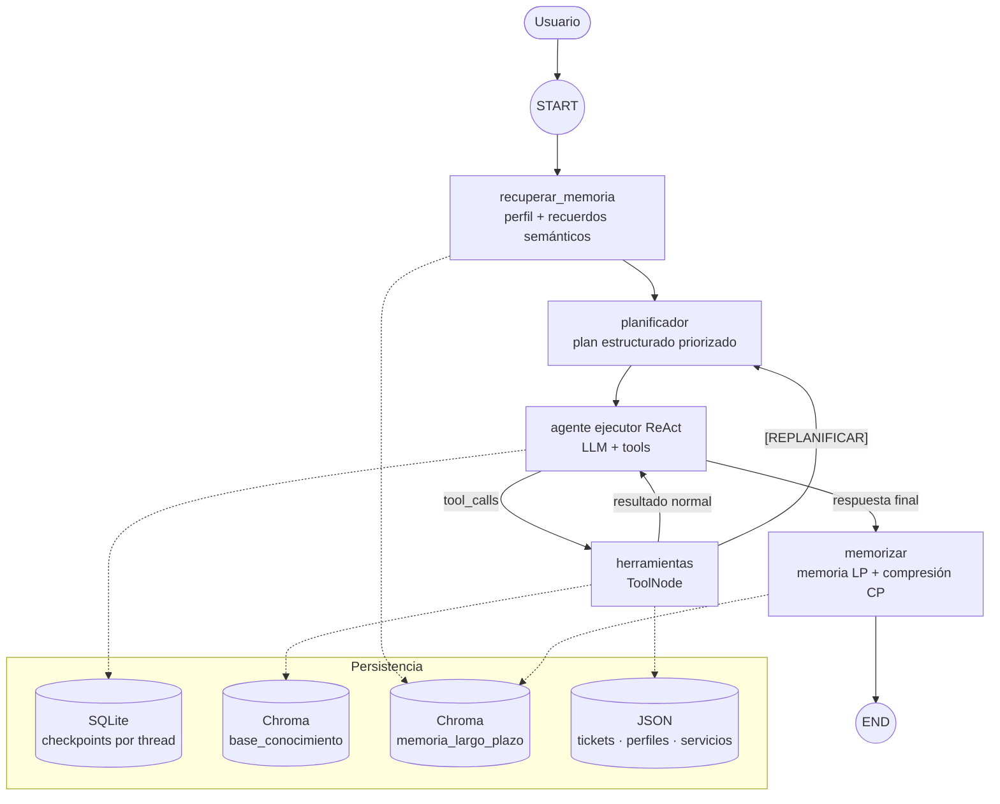
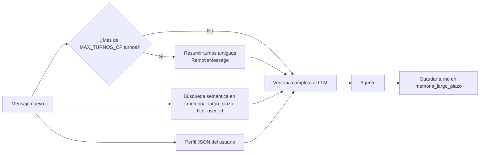
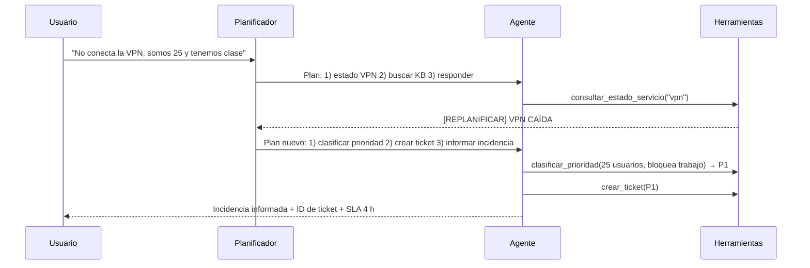

# 🤖 MesaTI — Agente de Soporte TI con LangGraph

> Proyecto ISY0101 · Ingeniería de Soluciones con IA · Evaluación Parcial N°2
> Integrantes: Ezequel Lorca

## 1. Problema organizacional

La mesa de ayuda TI recibe consultas repetitivas (bloqueo de cuentas, VPN, impresoras) y además incidentes que deben escalarse. **MesaTI** es un agente que resuelve consultas con la base de conocimientos oficial, verifica el estado de los servicios, razona la prioridad de los incidentes, registra tickets y recuerda el contexto de cada usuario entre sesiones.

## 2. Arquitectura

### 2.1 Diagrama de orquestación



### 2.2 Componentes

| Componente | Tecnología | Rol |
|---|---|---|
| Orquestación | LangGraph `StateGraph` | Flujo con nodos, enrutamiento condicional y ciclos de replanificación |
| LLM | Groq (`MODELO_LLM`) vía `langchain-groq` | Planificador (salida estructurada) y ejecutor (tool calling) |
| Embeddings | `paraphrase-multilingual-MiniLM-L12-v2` | Vectorización de consultas en español |
| Vector store | Chroma (coseno) | Base de conocimientos y memoria episódica |
| Memoria CP | `SqliteSaver` + ventana + resumen | Continuidad dentro de una sesión (`thread_id`) |
| Memoria LP | Chroma filtrado por `user_id` + perfil JSON | Continuidad entre sesiones |
| Interfaz | Gradio | Chat + panel para simular cambios del entorno |

### 2.3 Herramientas

| Tipo | Herramienta | Descripción |
|---|---|---|
| Consulta | `buscar_base_conocimiento` | RAG con umbral de relevancia; devuelve `[SIN_RESULTADOS]` si no hay respaldo |
| Consulta | `consultar_estado_servicio` | Estado del servicio; emite `[REPLANIFICAR]` si no está operativo |
| Consulta | `consultar_tickets` | Tickets del usuario |
| Consulta | `recordar_historial_usuario` | Búsqueda semántica en memoria de largo plazo |
| Razonamiento | `clasificar_prioridad` | Matriz impacto × urgencia → P1–P4 + SLA |
| Escritura | `crear_ticket` | Crea ticket o vincula a uno abierto de la misma categoría |
| Escritura | `actualizar_ticket` | Cambia estado y agrega notas |
| Escritura | `guardar_dato_usuario` | Persiste datos estables del usuario |

## 3. Memoria y recuperación de contexto



- **Corto plazo:** cada `thread_id` se persiste en `memoria/checkpoints.sqlite`. Al superar `MAX_TURNOS_CP`, los mensajes antiguos se resumen y se eliminan del estado.
- **Largo plazo:** cada interacción se guarda con metadatos (`user_id`, `fecha`, `categoria`) y se recupera por similitud en la siguiente sesión.

## 4. Planificación y toma de decisiones



| Condición | Decisión del agente |
|---|---|
| Fuente relevante encontrada | Responde citando `[Fuente N]` |
| `[SIN_RESULTADOS]` y el usuario reporta un problema | Mensaje estándar + ticket de escalamiento |
| Servicio no operativo | Replanifica, no entrega pasos habituales, crea/vincula ticket |
| Ticket abierto de la misma categoría | Vincula el reporte en vez de duplicar |
| Varios problemas | Los atiende en orden de prioridad del plan |

## 5. Instalación y ejecución

### Google Colab (recomendado)
1. Abrir `Evaluacion_EP2_agente.ipynb` en Colab.
2. En 🔑 **Secrets**, crear `GROQ_API_KEY` con su clave de https://console.groq.com.
3. Ejecutar todas las celdas en orden (`Entorno de ejecución → Ejecutar todas`).

### Local
```bash
git clone <url-del-repositorio>
cd <repositorio>
python -m venv .venv && source .venv/bin/activate   # Windows: .venv\Scripts\activate
pip install -r requirements.txt
cp .env.example .env        # y completar GROQ_API_KEY
jupyter notebook Evaluacion_EP2_agente.ipynb
```

Variables de entorno:

| Variable | Obligatoria | Descripción |
|---|---|---|
| `GROQ_API_KEY` | Sí | Clave de Groq |
| `MODELO_LLM` | No | Modelo de Groq con soporte de tool calling |

## 6. Pruebas

- **Unitarias (Sección 8 del notebook):** prioridad, umbral RAG, detección de servicio caído, creación sin duplicados y consulta de tickets. No consumen el LLM.
- **Escenarios (Sección 9):** consulta resoluble, VPN caída a mitad de conversación, problema fuera de la KB, múltiples problemas, memoria de corto plazo, memoria de largo plazo y flujo prolongado con compresión.

## 7. Estructura del repositorio

```
├── Evaluacion_EP2_agente.ipynb   # Implementación completa
├── README.md
├── requirements.txt
├── .env.example
├── .gitignore
└── docs/                         # Diagramas, capturas de pruebas, informe PDF
```

Las carpetas `data/`, `chroma_db/` y `memoria/` se generan al ejecutar el notebook.

## 8. Justificación de decisiones de diseño

> ✍️ **Completar por el equipo** (la pauta prohíbe redactar justificaciones técnicas con IA). Sugerencia de puntos a justificar: por qué LangGraph en vez de un agente lineal, por qué embeddings multilingües, por qué el umbral de relevancia elegido, por qué SQLite para memoria de corto plazo y Chroma para largo plazo, y por qué una matriz impacto × urgencia.

## 9. Declaración de uso de IA

> ✍️ **Completar por el equipo:** herramientas de IA usadas, en qué partes y cómo se validó el contenido.

## 10. Referencias

Chase, H. (2022). *LangChain* [Software]. GitHub. https://github.com/langchain-ai/langchain

Chroma. (2023). *Chroma: The AI-native open-source embedding database* [Software]. GitHub. https://github.com/chroma-core/chroma

Groq. (2025). *GroqCloud documentation*. https://console.groq.com/docs

LangChain. (2024). *LangGraph* [Software]. GitHub. https://github.com/langchain-ai/langgraph

Lewis, P., Perez, E., Piktus, A., Petroni, F., Karpukhin, V., Goyal, N., Küttler, H., Lewis, M., Yih, W., Rocktäschel, T., Riedel, S., & Kiela, D. (2020). Retrieval-augmented generation for knowledge-intensive NLP tasks. *Advances in Neural Information Processing Systems, 33*, 9459–9474. https://arxiv.org/abs/2005.11401

Reimers, N., & Gurevych, I. (2019). Sentence-BERT: Sentence embeddings using Siamese BERT-networks. In *Proceedings of EMNLP-IJCNLP 2019* (pp. 3982–3992). https://arxiv.org/abs/1908.10084

Reimers, N., & Gurevych, I. (2020). Making monolingual sentence embeddings multilingual using knowledge distillation. In *Proceedings of EMNLP 2020* (pp. 4512–4525). https://arxiv.org/abs/2004.09813

Wang, L., Xu, W., Lan, Y., Hu, Z., Lan, Y., Lee, R. K.-W., & Lim, E.-P. (2023). Plan-and-solve prompting: Improving zero-shot chain-of-thought reasoning by large language models. In *Proceedings of ACL 2023* (pp. 2609–2634). https://arxiv.org/abs/2305.04091

Yao, S., Zhao, J., Yu, D., Du, N., Shafran, I., Narasimhan, K., & Cao, Y. (2023). ReAct: Synergizing reasoning and acting in language models. In *International Conference on Learning Representations (ICLR)*. https://arxiv.org/abs/2210.03629
